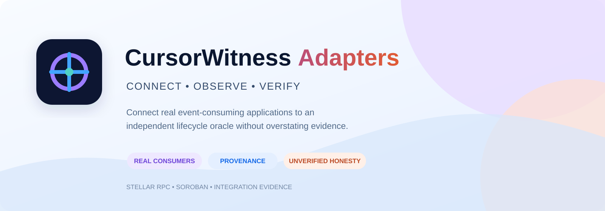
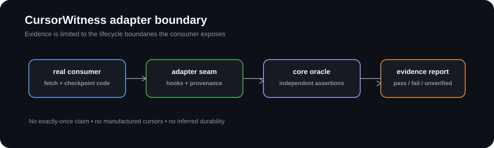

# CursorWitness Adapters



[](https://github.com/CursorWitness/cursorwitness-adapters/actions/workflows/ci.yml)
[](LICENSE)
[](https://nodejs.org/)
[](#current-limitations)

Consumer-specific integration seams for [CursorWitness](https://github.com/CursorWitness).

This repository connects real event-consuming applications to the provider-neutral CursorWitness engine. It records the boundaries an adapter can actually observe and leaves unsupported boundaries explicitly `unverified`.

## Repository role

Adapters connect real consumers to independently recorded lifecycle evidence:

```text
real consumer ──► adapter seam ──► lifecycle observations
       │                              │
       └── source/license evidence ───┘
                                      │
                                      ▼
                           core oracle + report
```

The current adapter targets the local `soroban-indexer-ts` integration boundary. It is a feasibility and compatibility seam, not a claim that the upstream consumer is universally correct.

## What this repository owns

- consumer-specific adapter seams and finite test entry points;
- source revision, dependency, and license records;
- delivery, effect, and checkpoint observation hooks;
- integration evidence evaluated by the independent
  [`@cursorwitness/core`](https://github.com/CursorWitness/cursorwitness-core)
  oracle.

It does not reimplement the CursorWitness core and does not claim universal
consumer correctness, database durability, cursor completeness, or exactly-once
business processing.

## Local verification

```bash
pnpm install --frozen-lockfile
pnpm run build
pnpm run package:check
pnpm run cursorwitness:check
```

`cursorwitness:check` injects a deterministic crash after an effect commit and
before checkpoint persistence. The restart trace is evaluated by the core
oracle and must report the duplicate committed-effect invariant.

## Current limitations

- the upstream fork's SQLite tests require a working `better-sqlite3` native
  binding;
- the current fetch path does not yet expose cursor continuation;
- the fork's license must be confirmed before distributing this adapter;
- durability evidence remains `unverified` unless the real persistence boundary
  is observed.

## Contributing

Keep adapter-specific behavior here. Extend the core only for provider-neutral
contracts. Every adapter change must identify the consumer revision, license,
failure boundary, and exact verification command.

See [`CONTRIBUTING.md`](CONTRIBUTING.md) for the repository contribution workflow.

## Related repositories

- [`cursorwitness-core`](https://github.com/CursorWitness/cursorwitness-core) — contracts, fixtures, oracle, and report model
- [`cursorwitness-cli`](https://github.com/CursorWitness/cursorwitness-cli) — offline executable and report presentation

## Visual guide



## License

Apache-2.0 for the CursorWitness adapter code. Third-party consumer code remains subject to its own license and provenance review.

See also: [`LICENSE`](LICENSE) · [`SECURITY.md`](SECURITY.md) · [`CODE_OF_CONDUCT.md`](CODE_OF_CONDUCT.md) · [`CHANGELOG.md`](CHANGELOG.md) · [`CURSORWITNESS_ADAPTER.md`](CURSORWITNESS_ADAPTER.md)
